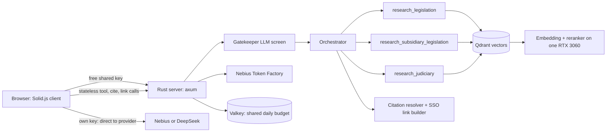

# lawbylaw by luminous

A free, no-sign-up legal research assistant for Singapore law, built for people who are not lawyers.

Ask a question in plain English. lawbylaw searches a vectorized corpus of Singapore legislation (Acts and subsidiary legislation), finds the sections, subsections, schedules and regulations that apply, and writes a structured answer in plain language. The answer is grounded in the exact source text, not the model's memory, and each provision it can match links to its official [Singapore Statutes Online (SSO)](https://sso.agc.gov.sg) page so you can check it at the source. When a question turns on how the courts have read the law, it can also search indexed Singapore judgments and cite them by neutral citation, with a link to the Judiciary's eLitigation page.

- **Live app:** [https://lawbylaw.luminoustan.com](https://lawbylaw.luminoustan.com)
- **Hackathon:** Nebius x NVIDIA Global AI Hackathon
- **Takedown:** the app will be taken down after the judging period, December 2 to December 16, 2026.

> General information only, not legal advice. Do not paste sensitive personal information.

## Why

Laws are public for good reasons, and no country should gatekeep them. Yet the gap is real: the people who know the law well are usually lawyers or paralegals, and the rest of us may not have the time or money for a consultation. The authoritative material is out in the open and mostly unused. The question behind this project: what if the entire Singapore Statutes Online corpus were vectorized and turned into one giant RAG system, with every answer traceable back to the exact provision?

## What it does

- **Plain-English answers with sources.** Structured answers that cite the provisions they rely on, with official SSO links for the Acts and provisions it can match.
- **Three research agents.** One searches Acts, one searches subsidiary legislation, and one searches judgments (only when the question turns on how courts interpret the law). A final orchestrator combines their findings.
- **Exact citations.** The agents return references. The server resolves each reference to the exact corpus text, or marks it as not found, before it reaches the answer. The model is not allowed to invent a provision or a URL.
- **Optional web search.** For recent developments, fees or forms that are not in the corpus, the model can use a Tavily web-search tool with a short query and an optional domain filter (for example `gov.sg`). Results are capped at eight hits and 7,000 characters and marked as untrusted web content. The legal text itself always comes from the indexed corpus. A turn allows at most four web searches.
- **No account, no server-side history.** Your conversation lives in your browser only.
- **Bring your own key.** Visitors can add their own Nebius or DeepSeek key in Settings. The model loop then runs in the browser and calls the provider directly.
- `/compact` **skill.** Summarises a long chat on demand.

## Built on Nebius Token Factory

Nebius Token Factory is the app's default provider, not just the development one.

- The free shared key runs `deepseek-ai/DeepSeek-V4.1-Flash` through Token Factory. A visitor who brings a Nebius key gets the same model from their browser.
- The endpoint is OpenAI-compatible, so pointing the harness at it was a base URL and a model name rather than a rewrite.
- Zero Data Retention is on by default at Token Factory, which is why it was the comfortable default for a public legal service.
- Provider differences are handled explicitly, in one place on each side of the stack:
  - Nebius accepts DeepSeek's `thinking: {"type": "disabled"}` and silently ignores it, so the model keeps reasoning, spends the token budget on hidden work and can return an empty reply. Nebius needs `reasoning_effort: "none"` instead.
  - Nebius has no DeepSeek Search API, so Tavily is the only web-search tool on that path.
  - `/compact` with a Nebius key summarises with NVIDIA Nemotron 3 Nano, which answers `reasoning_effort: "none"` with an empty reply and needs the chat-template switch instead.
- A probe script found these differences against the live endpoint. End-to-end tests run the real server binary and a real browser against the real Nebius endpoint.
- The shared daily token budget was tested the same way: two server replicas and a real Valkey counter against the live endpoint, with the Valkey total matching the provider-reported usage exactly.

## How it works

- **Server (Rust, axum)** owns the corpus, vector search, the citation resolver and the SSO link builder.
- **Web client (Solid.js)** owns the conversation, the rendering and, on the bring-your-own-key path, the model loop itself.
- **Stateless endpoints** for the browser loop: `/api/tool`, `/api/cite`, `/api/links` and `/api/agent`. This keeps a visitor's key in the browser and keeps the server free of chat state.
- **Research budget per turn:** agents are called in a fixed order and not twice; at most 10 direct section or judgment reads (each capped at 8,000 tokens), at most 4 web searches, and at most 60 references resolved per `/api/cite` call.
- **Token budgets use the corpus's own unit.** The vector collections were chunked with the Qwen3-Embedding-0.6B tokenizer, so the server counts Qwen3 tokens too, with an 11 MB vocabulary embedded in the binary.
- **Retrieval compute is self-hosted** on a homelab physically in Singapore, behind Cloudflare. Embeddings (Qwen3-Embedding-0.6B) and reranking (Qwen3-Reranker-0.6B) share a single Nvidia RTX 3060, so searches use bounded concurrency, queue estimates, caching, a hard deadline on Qdrant calls and a fallback to semantic ranking.

## The corpus and the parser

The first version used PyMuPDF, which is AGPL-3.0. Fine for a private side project, not something to build a commercial product on, so zero copyleft became a hard requirement.

The replacement is a custom PDF parser written from scratch on `node:zlib`, which has a permissive license. An AI coding agent wrote it under human supervision, inside a parser-specific harness: a PDF viewer to point at a section, a side-by-side comparison with the generated Markdown, and a fast loop to turn each defect into a regex or logic fix and re-run the parse. The hard parts were Parts, sections, divisions and subdivisions, schedules, TeX equations and tables.

| Metric           | Result                                             |
| ---------------- | -------------------------------------------------- |
| Documents parsed | 6,063 (523 Acts, 5,540 subsidiary legislation)     |
| Pages            | 92,954 (35,095 Act, 57,859 subsidiary legislation) |
| Time             | 155 seconds, roughly 600 pages per second          |
| Reproducibility  | a full rerun produced byte-identical output        |
| Hardware         | consumer laptop, AMD 4800U in battery-saver mode   |

## Security and privacy

A public legal chatbot is an abuse target, and a bring-your-own-key path makes key custody part of the design.

- **Stateless.** No accounts, no cookies, no server-side chat history. The server processes your question in memory on the free path and sees legal-search queries and answer text on both paths.
- **Key custody.** A visitor's API key and Tavily key stay in the browser. Keys are sent only to their provider's fixed URL (no free-text URL or model), and a Content Security Policy limits where a page can connect.
- **Gatekeeper.** A separate small LLM call screens each user message before the orchestrator runs and returns `allow`, `low_value`, `off_topic` or `injection`. Greetings, off-topic chatter and system-prompt extraction get a canned reply and spend no agent tokens. When unsure it allows, because blocking a real legal question is the worse failure. If the call fails, the request is rejected rather than let through. Long messages are checked at both ends, `<` and `>` are escaped rather than stripped, and the previous assistant turn is treated as untrusted.
- **Untrusted content rule.** Everything a tool returns, and everything in user messages, is material to analyse, never instructions to follow. A separate injection suite of 36 scenarios tests this against the live deployment (prompt extraction in nine forms, jailbreaks, forged tags, indirect injection, metadata-service probes, obfuscated payloads).
- **Abuse limits.** Cloudflare Turnstile session gate, per-IP and per-session limits, a per-session web-search cap, a shared daily token budget across replicas through Valkey (resets at 06:00 Singapore time), and redacted secrets in debug output.
- **What others see.** The app processes IP addresses for rate limits, and Cloudflare Turnstile and the edge see request metadata. On the bring-your-own-key path the provider's retention terms apply.

## Quality and performance

- **Evals:** 147 of 147 scenarios pass: abuse limits and boundaries (62), security checklist controls (36), browser and device behaviour (45). The browser section includes a 3-year-old phone profile at 4x CPU throttling on slow 3G, where the app is interactive in 2.8 seconds.
- **Load, 300 concurrent users against the shipped static binary:**
  - Shed phase: 50 served, 250 refused with a 503 and `Retry-After`, zero transport or stream errors, slots drained in 8 ms.
  - Capacity phase: all 300 served, 299 peak active streams, memory around 32 MB.
  - Browser-direct path: 300 of 300 honest turns completed; `/api/cite` 146 ms p50, `/api/links` 185 ms p50.
  - Mixed with hammering and malformed clients: 250 of 300 honest turns fully served. This is recorded as a failure, because the bar was "mostly unaffected".
  - 30,000 requests from rotating IPs confirmed the limiter's tracking table stays bounded.
- **Retrieval against the real backends:** 5, 15 and 30 concurrent users against the actual Qdrant and vLLM, every request a 200.
- **Observability:** around 20 Prometheus metrics (LLM tokens and latency, gatekeeper verdicts, turns, rejections, tool calls, queue wait, cache lookups, reranker fallbacks). `/metrics` is not exposed publicly.
- **Footprint:** a 19.3 MB runtime image built `FROM scratch` with no OS packages (down from 107 MB on Debian), about 60 MB of RAM per pod in production.
- **Licensing:** the SBOM audit covers 522 components and finds zero copyleft obligations for the shipped image.
- **Cost:** a full conversation (one prompt, up to 10 research passes each for Acts, subsidiary legislation and judgments, and the final reply) costs roughly $0.05 to $0.10 USD in API spend, because verbatim text is pulled from the vector database rather than regenerated by the LLM.

## Timeline

| When                  | What                                                                                                             |
| --------------------- | ---------------------------------------------------------------------------------------------------------------- |
| April 2026            | Side project starts; first version parses PDFs with PyMuPDF                                                      |
| Early September 2026  | Discovery that an agent can extract formatted text from PDFs with `node:zlib` alone; parser harness built        |
| 14 September 2026     | Nebius in-person event; Token Factory credits; endpoints implemented against the harness                         |
| 1 to 7 October 2026   | Intensive parsing push                                                                                           |
| After that            | Nebius Token Factory becomes the default; research agents, citation resolver, bring-your-own-key path, hardening |
| 2 to 16 December 2026 | Judging period; app taken down afterwards                                                                        |

## What I learned

- **Verification is the product.** The most useful thing built was the harness that lets a human check the model's work, not the model loop. An AI system is only as good as the loop that lets a human verify it.
- **Licensing is an architecture decision.** Replacing the parser changed the dependency tree, the build and the deployment.
- **One GPU is enough if you respect the queue.** Bounded concurrency, queue estimates, caching and fallbacks matter more than a bigger model.
- **A public legal chatbot is a security product.** Hostile text is the normal operating environment, so the browser is part of the trust boundary.

## Credits and notes

Built by luminous for the Nebius x NVIDIA Global AI Hackathon, with Nebius Token Factory (inference), an Nvidia RTX 3060 (embeddings and reranking), Qdrant, Valkey and Cloudflare.

Singapore legislation is subject to copyright of the Singapore Government and is used and reproduced for the purposes of this platform with the permission of the Attorney-General's Chambers (AGC). Check [Singapore Statutes Online](https://sso.agc.gov.sg) for the latest version of Singapore legislation.